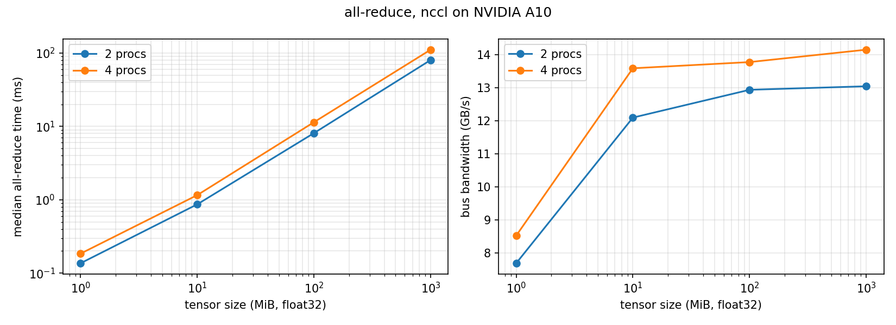

# 5.1 distributed_communication_single_node

NCCL all-reduce of a float32 tensor on NVIDIA A10s (PCIe, no NVLink) on Modal, with one process per GPU. Times are
the median of 20 timed iterations after 5 warm-up iterations. Each iteration is timed up to
`torch.cuda.synchronize()`, and the time is the max across ranks. algbw = size / time.
busbw = algbw · 2(n−1)/n, which is the data each GPU actually sends and receives in a ring all-reduce. busbw can be
compared across world sizes.

| procs | size (MiB) | median (ms) | algbw (GB/s) | busbw (GB/s) |
|------:|-----------:|------------:|-------------:|-------------:|
| 2 |    1 |   0.136 |  7.70 |  7.70 |
| 2 |   10 |   0.866 | 12.10 | 12.10 |
| 2 |  100 |   8.101 | 12.94 | 12.94 |
| 2 | 1000 |  80.350 | 13.05 | 13.05 |
| 4 |    1 |   0.184 |  5.69 |  8.53 |
| 4 |   10 |   1.157 |  9.06 | 13.59 |
| 4 |  100 |  11.413 |  9.19 | 13.78 |
| 4 | 1000 | 111.103 |  9.44 | 14.16 |

6 processes could not be measured. Modal caps A10 containers at 4 GPUs (`A10:6` is rejected). The two world sizes
also ran in separate containers, so their host topologies may differ.

**Commentary.** From 10 MiB upward, all-reduce time grows linearly with size, and bus bandwidth levels off at about
13–14 GB/s. That is the PCIe limit of this box, well below the ~32 GB/s per direction of PCIe 4.0 x16, which suggests
the traffic goes through the CPU or host memory rather than direct GPU-to-GPU. At 1 MiB the fixed per-call latency
(~0.1–0.2 ms) dominates, and bandwidth drops to 8 GB/s. Going from 2 to 4 processes makes each all-reduce slower
(1.38× at 1 GiB) because each GPU must move 2(n−1)/n · S: 1.5 S instead of 1.0 S. busbw stays flat or rises slightly,
so the ring scales well, and the extra cost per added GPU shrinks toward a constant 2·S/bandwidth. On a PCIe box, the
interconnect bandwidth and the tensor size are therefore the main factors, and the process count adds at most a 2×
factor on top. Small tensors are latency-bound at any world size, which argues for bucketing gradients into larger
all-reduces in DDP.
